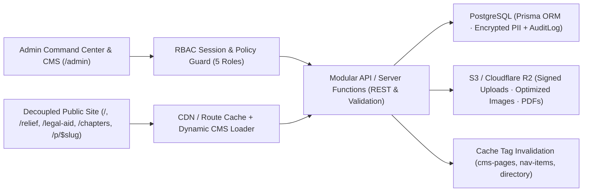
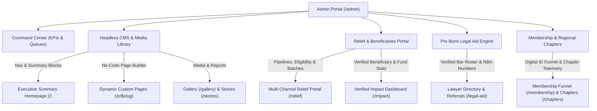

# Abba Roller Foundation (ARF) — Enterprise Admin Dashboard & Headless CMS Architecture

This architectural specification documents the full-stack Admin Command Center, Multi-Channel Relief Portal, Pro Bono Legal Case Engine, Nationwide Chapter Registry, and No-Code Headless CMS powering **Abba Roller Foundation (`abbarollerfoundation.com.ng`)**.

> **Codebase Note**: The live web runtime runs **TanStack Start + React 19 + TypeScript (strict) + Tailwind CSS v4 + Recharts + Nitro (Vercel)**. The relational database schema in [prisma/schema.prisma](file:///home/bmk/Desktop/ARF/abba-roller-foundation-1/prisma/schema.prisma) and REST/Server-Action contract below map cleanly to both Next.js App Router Route Handlers / Server Actions and TanStack Start `createServerFn` APIs backed by PostgreSQL + S3/R2.

---

## 1. High-Level System Architecture

### Core Architectural Guarantees
1. **Strict Multi-Role Isolation (RBAC)**: Every API mutation validates both authenticated session identity and granular permissions (`cms:publish`, `disbursements:approve`, `legal:manage`, `members:manage`, `audit:view`).
2. **NDPR Data Protection**: National Identification Numbers (`ninCiphertext`) and sensitive legal client names (`clientFullNameEnc`) are encrypted at rest via AES-256-GCM; list endpoints and admin data tables expose masked display values (`••• 8492`, initials) unless an authorized coordinator opens a verified audit session.
3. **Immutable Append-Only Audit Trail**: Every batch approval, beneficiary status transition, case attorney assignment, member verification, and CMS publish/rollback writes an immutable row in `AuditLog`.
4. **S3 / R2 Presigned Upload Pipeline**: Large field proof-of-delivery photos and annual impact PDFs upload directly via short-lived presigned URLs (`POST /api/media/presign`), with client-side image compression and WebP/JPEG normalization before persistence.

---

## 2. Role-Based Access Control (RBAC) Permission Matrix

| Capability / Permission Key | Super Admin | Program Officer | Legal Coordinator | State Chapter Lead | Content Editor |
| :--- | :---: | :---: | :---: | :---: | :---: |
| **View Command Center & Analytics** | Full | Full | Legal + National KPIs | Assigned State Only | Traffic / Content Summary |
| **Edit CMS Pages & Upload Media (`cms:edit`, `media:manage`)** | Yes | — | — | — | Yes |
| **Publish / Rollback CMS Pages & Nav (`cms:publish`)** | Yes | — | — | — | Draft Only (Needs Approval) |
| **Manage Beneficiaries & Relief Applications (`relief:manage`)** | Yes | Yes | — | View State Beneficiaries | — |
| **Approve & Disburse Relief Batches (`disbursements:approve`)** | Yes | Yes | — | — | — |
| **Manage Pro Bono Attorneys & Legal Cases (`legal:manage`)** | Yes | — | Yes | — | — |
| **Approve Members & Manage Chapters (`members:manage`, `chapters:manage`)** | Yes | Read-Only | — | Assigned State Scope | — |
| **Inspect Immutable Audit Logs (`audit:view`)** | Yes | Department Scope | Legal Scope | — | — |
| **Manage Admin Users & RBAC Roles (`settings:manage`)** | Yes | — | — | — | — |

---

## 3. Navigation & Information Architecture (IA) Map

How the Admin Dashboard & Headless CMS directly governs the decoupled public website routes:

| Public Route | Public Purpose | Admin CMS / Operations Backing Module |
| :--- | :--- | :--- |
| `/` | High-impact executive summary (Mission hero, 3 entry pathways, trust metrics, founder mandate) | **CMS Navigation & Executive Blocks** |
| `/relief` | Multi-channel disbursements, eligibility criteria, 4-step protocol & field galleries | **Module C: Relief Pipelines, Beneficiaries & Batches** |
| `/legal-aid` | Indigent case eligibility, confidential referrals, searchable Bar Directory & enrollment | **Module D: Attorney Directory & Case Matching Engine** |
| `/chapters` | Regional chapter explorer across Jigawa, Kano, 10-State Corridor & FCT Abuja | **Module E: State Chapter Coordination & Rosters** |
| `/membership` | Nationwide 36-state + FCT registration funnel & instant downloadable PNG ID Card | **Module E: Member Onboarding Pipeline** |
| `/volunteer` | Humanitarian volunteer corps & pro bono practitioner intake | **Module E: Volunteer Corps Registry** |
| `/impact` | Verified accountability reporting & Jigawa–Kano corridor analytics | **Module A + C: Telemetry & Audit Aggregates** |
| `/p/$slug` | Dynamic custom pages authored zero-code in `/admin` (e.g. `/p/scholarship-bursary-2026`) | **Module B: Headless Block Builder & Version Rollback** |
| `/admin` | Protected multi-module Operations Console & Headless CMS (`noindex, nofollow`) | **All Modules (A–E + RBAC & Audit Log)** |

---

## 4. Production REST / Server-Function API Contract

| Endpoint / Server Action | Method | Auth / Permission | Purpose |
| :--- | :--- | :--- | :--- |
| `/api/cms/pages` | `GET` / `POST` | Public (published) / `cms:edit` | List CMS pages or create a new custom `/p/$slug` draft |
| `/api/cms/pages/:id/publish` | `POST` | `cms:publish` | Publish draft, save immutable `CmsPageVersion`, revalidate public route |
| `/api/cms/pages/:id/rollback` | `POST` | `cms:publish` | Restore blocks & SEO metadata from a prior `CmsPageVersion` |
| `/api/cms/navigation` | `GET` / `PUT` | Public / `cms:publish` | Reorder, rename, or toggle top-level navigation visibility |
| `/api/media/presign` | `POST` | `media:manage` | Generate short-lived S3/R2 signed PUT URL and register `MediaAsset` |
| `/api/relief/beneficiaries` | `GET` / `POST` | `relief:manage` | Paginated search with masked NINs, vulnerability filters & bulk approval |
| `/api/relief/batches` | `GET` / `POST` | `disbursements:approve` | Create regional disbursement batch with proof photos & CSV/PDF audit export |
| `/api/legal/cases` | `GET` / `POST` / `PATCH` | `legal:manage` | Log inmate/indigent cases, assign NBA-verified attorney & advance milestone |
| `/api/legal/attorneys` | `GET` / `PATCH` | Public (verified) / `legal:manage` | Onboard advocates, verify NBA enrollment numbers & update active status |
| `/api/community/members` | `GET` / `PATCH` | `members:manage` | Review citizen registrations, approve status & issue digital ID cards |
| `/api/chapters` | `GET` / `PATCH` | Public / `chapters:manage` | Assign state coordinators and publish state-level chapter announcements |
| `/api/audit-logs` | `GET` | `audit:view` | Query immutable actor, entity, timestamp & diff metadata logs |
